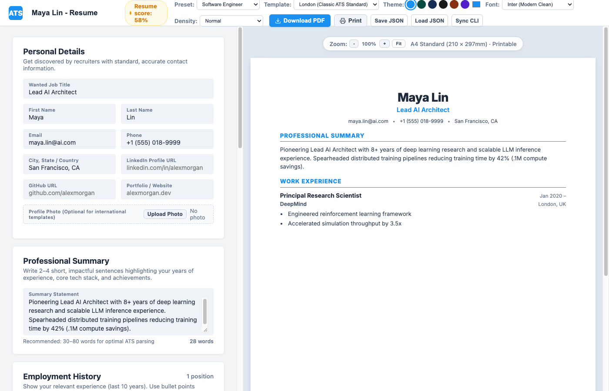
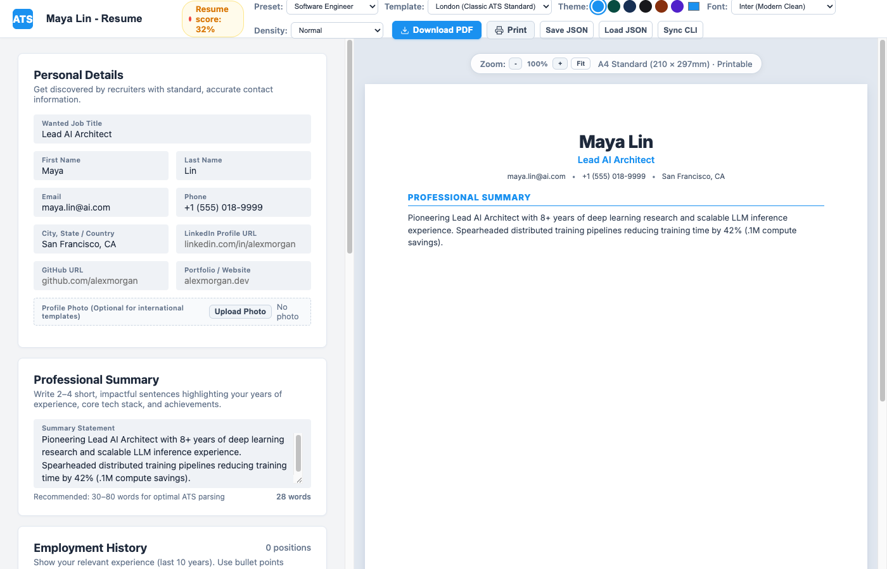

# Universal ATS Resume Builder & Candidate Automation System

[](LICENSE)
[](#zero-setup-quickstart)
[](#8-cloned-ats-templates)
[](#antigravity-cli--ai-agent-skill)

An uncluttered, modern **Resume Maker** and **Candidate Automation Engine** modeled after [Resume.io](https://resume.io). It features **8+ ATS-optimized templates**, real-time ATS scoring, A4 printable formatting, zero-dependency browser execution, and an automated CLI for AI agents (like **Antigravity CLI**).



---

## ⚡ Zero-Setup Quickstart

No build steps. No `npm install`. No Webpack. Just download and run:

### Method 1: Instant Browser Execution (Double-Click)
1. Download or clone this repository:
   ```bash
   git clone https://github.com/Bdevvv/resume-builder.git
   cd resume-builder
   ```
2. **Double-click `index.html`** in your file manager, or open it in any browser (Chrome, Brave, Safari, Edge, Firefox).
3. Start editing your resume, switch templates, preview in real time, and click **Download PDF** or **Print**.

### Method 2: Local Web Server (Optional)
```bash
npm start
# or: python3 -m http.server 8080
```
Visit `http://localhost:8080`.

---

## 🤖 Antigravity CLI & AI Agent Skill

This repository includes a dedicated agent skill in `.gemini/skills/resume-builder/SKILL.md`.

When running in **Antigravity CLI (`agy`)** or with an AI coding agent, simply say:
> *"Create an ATS resume for Maya Lin, Lead AI Architect at OpenAI..."*

The AI agent will invoke the built-in skill, parse the candidate's achievements, and run the automated candidate generator:

```bash
node bin/resume-cli generate \
  --name "Maya Lin" \
  --title "Lead AI Architect" \
  --email "maya.lin@ai.com" \
  --summary "Pioneering Lead AI Architect with 8+ years deep learning..." \
  --template london
```

### What gets created automatically:
📂 **`../Maya Lin resume/`**
- `resume.html`: Pre-populated, self-contained Resume.io editor & preview for Maya Lin.
- `Maya_Lin_Resume.pdf`: Pre-compiled A4 vector PDF.
- `data/resume_data.json` & `data/resume_data.js`: Structured resume data.
- `assets/` (`css/`, `js/`, `lib/`): Self-contained offline dependencies.



---

## 🎨 8 Cloned ATS Templates (from Resume.io)

Reverse-engineered from [Resume.io](https://resume.io/resume-templates) using [`morluto/rea`](https://github.com/morluto/rea):

| Template | Layout & Visual Style | Best Suited For |
| :--- | :--- | :--- |
| **London** | Single-column, centered header, horizontal accent rules | Executive & Corporate (ATS Gold Standard) |
| **Stockholm** | Modern 2-column with left skills & contact sidebar | Software Engineers, Data Scientists |
| **Toronto** | Contemporary solid accent color header banner | Tech Leads, Product Managers, Marketing |
| **Dublin** | Minimalist single-column with vertical pip accents | Finance, Legal, Consulting (High Density) |
| **Vienna** | Classic corporate layout with Georgia serif & timeline | Directors, Senior Consultants, Researchers |
| **Sydney** | Creative contrast, deep full-bleed colored sidebar | Creative Leadership, Designers, Consultants |
| **Berlin** | Compact categorized skill matrix, dense bullet points | DevOps, Cloud Engineers, Systems Architects |
| **Athens** | Garamond serif typography, double-line classic dividers | Academia, Education, Traditional Institutions |

---

## 🖨️ A4 Printing & Bullet-Proof Formatting

- **Strict A4 Geometry**: Configured to exact A4 dimensions (`210mm × 297mm`) with `@page { size: A4 portrait; margin: 0; }`.
- **Anti-Break Pagination**: Uses `page-break-inside: avoid; break-inside: avoid;` so job entries are never cut across pages.
- **No Orphan Bullets**: Bullet points use `list-style-position: outside !important` so marker dots never wrap alone onto a new line.
- **Clean Contact Headers**: Contact separators use CSS pseudo-elements (`::before { content: "•"; }`) to prevent isolated hanging dots.

---

## 🛠️ CLI Reference (`bin/resume-cli`)

The CLI runs with pure Node.js standard libraries—no external npm modules needed:

```bash
# 1. Generate a candidate workspace in a new folder
node bin/resume-cli generate --name "John Doe" --title "Senior Backend Engineer"

# 2. Add an experience position to the active resume
node bin/resume-cli add-job --title "Staff Engineer" --company "Stripe" --start "2022-01" --current --bullets "Architected payment system;Scaled throughput by 40%"

# 3. Add skills
node bin/resume-cli add-skill --tech "Go, Kubernetes, AWS, PostgreSQL" --soft "System Design, Leadership"

# 4. View ATS Score breakdown in terminal
node bin/resume-cli show

# 5. Headless vector PDF export (using local Brave/Chromium)
node bin/resume-cli export-pdf --out resume.pdf
```

---

## 🧪 Testing & Verification

Run the automated test suite:

```bash
npm test
```

Executes 65 automated checks covering:
- All 8 templates rendering without null/undefined placeholders.
- Blank profile safety checks.
- ATS scoring engine accuracy (metrics and action verb detection).
- CLI candidate package generation and offline asset bundling.

---

## 📁 Repository Structure

```
resume-builder/
├── index.html              # Main application shell with Resume.io clean card UI
├── package.json            # npm metadata, bin symlink & scripts
├── .gitignore              # Git ignore rules
├── LICENSE                 # MIT License
├── README.md               # Documentation & guides
├── .gemini/skills/         # Antigravity CLI skill
│   └── resume-builder/SKILL.md
├── bin/
│   └── resume-cli          # Standalone executable CLI (zero external deps)
├── css/
│   ├── app.css             # Resume.io light card UI stylesheet
│   └── templates.css       # Layouts & print styles for all 8 templates
├── js/
│   ├── app.js              # UI interactivity, state, local sync & PDF export
│   ├── templates.js        # Semantic HTML renderers for all 8 templates
│   ├── ats-checker.js      # ATS scoring engine (0-100) & keyword scanner
│   ├── sample-data.js      # Realistic presets (Software Engineer, PM, Blank)
│   └── cli-core.js         # Core candidate generator engine
├── data/
│   ├── resume_data.json    # Machine-readable JSON resume state
│   └── resume_data.js      # Zero-CORS browser data bridge
├── lib/
│   └── html2pdf.bundle.min.js  # Client-side vector PDF generation
└── tools/
    ├── verify_templates.js # Template unit test suite
    ├── verify_cli.js       # CLI automation test suite
    └── rea/                # Reverse-engineering specs from morluto/rea
```

---

## 📄 License

MIT © [Bhadresh Das](https://github.com/Bdevvv)
